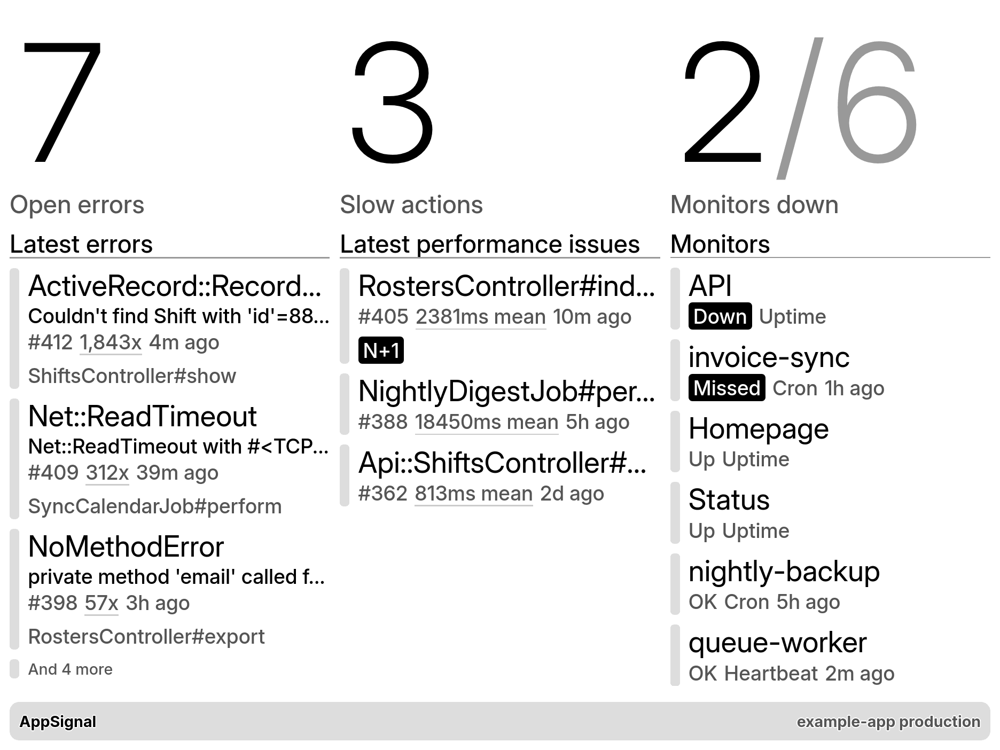

# AppSignal for TRMNL

A TRMNL plugin that shows an AppSignal app's open incidents and uptime
monitors. Built for the TRMNL X (1872 by 1404, 16 grays) and still readable on
the original TRMNL.



| View | Shows |
|------|-------|
| Full | Open error count, slow action count, monitors down, latest errors, latest performance issues (errors only in portrait) |
| Half (either way) | Open error count, monitors down, latest errors |
| Quadrant | Open error count with a one-line summary, plus the latest error on the TRMNL X |

TRMNL polls AppSignal's GraphQL API directly every 15 minutes, so no server of
your own is needed. It signs in with OAuth and asks only for the `app:read`
scope: TRMNL never holds a personal API token, and the token it does hold can
only read, belongs to one organization, and can be revoked on its own.

## Install

1. Open the [AppSignal recipe](https://trmnl.com/recipes/appsignal-518240) on
   TRMNL and click **Install**, or **Fork** to take a copy that does not receive
   updates (see below).
2. On the plugin's settings page, paste
   `SSxE-b54Nak88428BadY9JQeDS0sck3JGgycXSIL2ho` into **OAuth Client ID**,
   leave **OAuth Client Secret** empty, and save. TRMNL does not copy the
   client ID when it installs a recipe. To use your own client instead, see
   [Using your own OAuth client](#using-your-own-oauth-client).
3. Click **Connect with OAuth**, approve read access in AppSignal, and pick
   the app you want on the screen.
4. Fill in the organization name, which is the part after `appsignal.com/` in
   the address bar when you open AppSignal (`appsignal.com/<organization>/...`).
5. Save, and add the plugin to a playlist.

Enter `demo` as the organization to see example data without connecting.

### Using your own OAuth client

Every install that pastes the client ID above shares one AppSignal OAuth client.
If AppSignal rate-limits or revokes that client, every one of those installs
stops refreshing at once. To keep yours independent, register your own client
and paste its ID in step 2 instead:

```sh
curl -X POST https://appsignal.com/oauth/register \
  -H 'Content-Type: application/json' \
  -d '{"client_name": "TRMNL AppSignal display",
       "redirect_uris": ["https://trmnl.com/plugin_settings/private_plugin/oauth/redirect"],
       "grant_types": ["authorization_code", "refresh_token"],
       "response_types": ["code"],
       "token_endpoint_auth_method": "none",
       "scope": "app:read"}'
```

The `client_id` in the response is the ID to paste. It needs no secret, and
nothing else about the plugin changes.

## What installers trust

Installing the recipe (rather than forking it) means taking every update its
publisher pushes, and each update runs with the installer's AppSignal token. A
publisher, or anyone who takes over the publisher's TRMNL account, could change
where the plugin sends requests and collect those tokens. Each token can only
read, and only what its installer approved. To limit this:

- The publisher keeps two-step sign-in on for TRMNL and GitHub.
- Installers who would rather not take updates choose **Fork**, which copies the
  plugin as it is.
- Anyone can revoke the plugin's access in AppSignal at any time.

## Limits

- Counts stop at 100 per incident type and show as "99+" beyond that.
- A monitor counts as down when it has an alert in the `OPEN` state.
- AppSignal asks which app to allow when you connect. A token limited to that
  app should leave only that app in the organization list. This is untested with
  an organization that has several apps; until then the screen shows the first
  app the token can read.
- A blank or wrong organization name shows AppSignal's "Object not found." An
  expired or revoked connection shows "Request could not be authenticated."

## Contributing

Bug reports, ideas, and pull requests are welcome. [CONTRIBUTING.md](CONTRIBUTING.md)
covers local development, the tests, and running your own copy of the plugin.
Everyone taking part follows the [code of conduct](CODE_OF_CONDUCT.md). Report
security problems privately, as [SECURITY.md](SECURITY.md) describes.

## License

[MIT](LICENSE)
